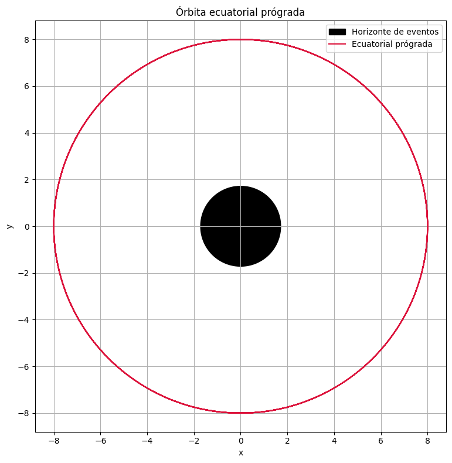
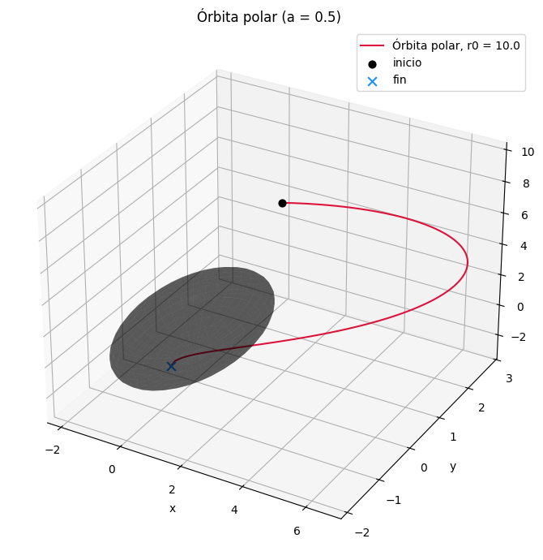

# Numerical Integration of Geodesics in the Kerr Metric

**General relativity | Numerical methods | Universidad de Antioquia | 2025**  
**Author:** Manuela Marín Gómez  
**Context:** Individual computational project for *Celestial Mechanics*, taught by Prof. Jorge I. Zuluaga.

> **Portfolio version — under review.** This repository organizes the original 2025 course notebook. Several implementation details, especially the sign of retrograde orbital angular velocity and the coordinate visualization, should be checked before treating all plots as physically validated. See [`REVIEW_NOTES.md`](REVIEW_NOTES.md).

## Overview

The project studies timelike orbital motion around a rotating compact object described by the Kerr metric. It explores the Schwarzschild limit, a first-order slow-rotation approximation, symbolic computation of Christoffel symbols, and numerical integration of geodesic equations. The notebook also investigates equatorial and inclined trajectories, including prograde and *intended* retrograde configurations.

## Scientific background

### 1. Schwarzschild and Kerr metrics

Kerr spacetime describes the vacuum geometry outside an idealized rotating, uncharged black hole. In Boyer–Lindquist coordinates $(t,r,\theta,\phi)$, define in geometrized units $G=c=1$:

$$
\Sigma=r^2+a_{\rm len}^2\cos^2\theta,\qquad
\Delta=r^2-2Mr+a_{\rm len}^2,
$$

where $M$ is the central mass and $a_{\rm len}=J/M$ is the rotation parameter with dimensions of length. The notebook instead uses $s=GM/c^2$ and dimensionless spin $a_*=Jc/(GM^2)$, so $a_{\rm len}=a_*s$. Taking $a_*=0$ recovers Schwarzschild geometry. The off-diagonal term $g_{t\phi}$ captures the coupling between time and azimuth and is related to **frame dragging**.

### 2. Equations of motion

For a freely falling test particle, the worldline obeys the geodesic equation

$$
\frac{d^2x^\mu}{d\tau^2}+
\Gamma^\mu_{\alpha\beta}
\frac{dx^\alpha}{d\tau}
\frac{dx^\beta}{d\tau}=0,
$$

with Christoffel symbols

$$
\Gamma^\mu_{\alpha\beta}=
\frac{1}{2}g^{\mu\nu}
\left(\partial_\alpha g_{\nu\beta}
+\partial_\beta g_{\nu\alpha}
-\partial_\nu g_{\alpha\beta}\right).
$$

The notebook constructs metric tensors and connection coefficients symbolically (`sympy` and `einsteinpy`), turns these symbolic expressions into numerical functions, and integrates the resulting first-order ordinary differential equations using `scipy.integrate.solve_ivp`.

### 3. Slow-rotation limit and conserved norm

In the small-spin limit $|a_*|\ll1$, the metric can be expanded to first order in $a_*$. For a timelike geodesic parameterized by proper time,

$$g_{\mu\nu}U^\mu U^\nu=c^2$$

(or $1$ when using geometrized coordinates). The notebook explicitly investigates this normalization as a numerical consistency check for one of its approximations.

### 4. Prograde and retrograde trajectories

For circular equatorial Kerr geodesics, the signed coordinate angular velocities in geometrized units can be expressed as

$$
\Omega_{\pm}=\pm\frac{\sqrt{M}}{r^{3/2}\pm a_{\rm len}\sqrt M}.
$$

The plus branch is prograde for positive spin, while the minus branch is retrograde and **must have negative coordinate angular velocity** in the convention used here. The original `Omega_circular_kerr` function does not assign a negative sign to the retrograde branch. Therefore, retrograde plots in the original notebook require correction and regeneration before being used as validated examples.

The event horizons lie at $r_{\pm}=M\pm\sqrt{M^2-a_{\rm len}^2}$ in geometrized units; they are not themselves curvature singularities.

## Selected figures

These figures are extracted from the original notebook; treat them as **illustrations pending verification**.

*An equatorial-orbit visualization in the original notebook.*

*Illustrative non-equatorial trajectory. The notebook uses a simplified Cartesian visualization mapping; see review notes.*

## Repository structure

- `notebooks/kerr_geodesics.ipynb` — cleaned portfolio copy of the original computational solution.
- `figures/` — selected images from executed notebook cells.
- `docs/theory_es.md` — concise theoretical overview in Spanish.
- `REVIEW_NOTES.md` — implementation details requiring checking.

## How to run

1. Install dependencies listed in `requirements.txt` in a dedicated Python environment.
2. Open `notebooks/kerr_geodesics.ipynb` in Jupyter or Google Colab.
3. Execute cells in order; symbolic tensor manipulations can be computationally expensive.

**Execution status:** the notebook was inspected and packaged, but not re-executed or independently validated during this preparation.

## Credits and research integrity

Created for *Celestial Mechanics*, Universidad de Antioquia (instructor: Prof. Jorge I. Zuluaga). The original course assignment and the student's personal ID have been removed. The notebook already identifies specific visualization and tensor-conversion blocks that used ChatGPT or Gemini assistance; these disclosures were **retained**. The README is later portfolio documentation, not a peer-reviewed research publication.
